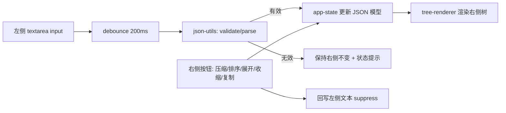

## 产品概述

一个 Chrome 扩展（Manifest V3），用于把 JSON 文本或 JSON 字符串快速格式化、压缩与浏览。点击扩展图标后打开一个独立标签页，页面整屏铺满，黑色主题，左右分栏：左侧编辑原始文本，右侧实时呈现可折叠的彩色 JSON 结果，无任何多余区域。

## 核心功能

- **左侧功能区**：按钮行为「反转义」「格式化」「清空」；下方为带行号的文本编辑区，输入内容支持彩色高亮。
- **右侧功能行**：「复制」「压缩」「全部展开」「全部收缩」「排序（按键名首字母排序）」；下方为带行号的结果区。
- **实时联动**：左侧内容变化时先校验 JSON；有效则右侧自动展示格式化结果（默认仅展开根节点，更深层折叠）；无效则右侧内容保持不变，并给出无效提示。
- **折叠与展开**：右侧结果按节点折叠/展开，支持一键全部展开、全部收缩。
- **彩色展示**：两侧内容为有效 JSON 时按语法着色（键、字符串、数字、布尔、null、标点各自配色）。
- **行号与滚动**：两侧内容区均显示行号；内容超出可视区域时出现滚动条，过宽的行自动换行。
- **视觉要求**：以黑色为主的主题，全屏无干扰，界面参考 2026.json.cn 的深色编辑器风格。
- **扩展性**：代码按区域与功能拆分模块，后续新增功能只需新增独立模块并注册，不修改既有逻辑。

## 技术栈选择

- 平台：Chrome 扩展 Manifest V3（独立标签页形式，不使用 popup）。
- 语言：TypeScript 4.9 + `@types/chrome`，与已有插件 `/Users/chu/Documents/wwwroot/chrome/tts` 保持一致的构建习惯。
- 构建：`tsc` 编译到 `dist/`，构建脚本形如 `"build": "tsc && npm run copy-files"`（拷贝 `manifest.json`、`index.html`、`styles/*.css` 到 dist）。
- 运行时：零第三方依赖，原生 DOM API + CSS 变量主题；不引入框架/UI 库，避免冗余。
- 目标：`target/module = ES2020`，页面以 `<script type="module">` 加载产物。

## 实现方案

### 总体策略

页面 = 左面板（可编辑高亮编辑器）+ 右面板（可折叠树视图）+ 顶部各自按钮行；由 `app-state` 单向数据流驱动：左侧输入 → 防抖 → JSON 校验 → 更新内部数据模型 → 重渲染右侧。所有 JSON 处理逻辑收敛为纯函数，视图与逻辑分离。

### 关键决策与理由

1. **入口（独立标签页）**：manifest 中 `"action": {}` 不带 `default_popup`，此时点击图标触发 `chrome.action.onClicked`；在 background service worker 中 `chrome.tabs.create({ url: chrome.runtime.getURL('index.html') })`。理由：MV3 只有未声明 popup 才会触发 onClicked；`chrome.tabs.create` 无需额外权限（因此 `permissions` 可为空）。
2. **ESM 与 tsc 的配合**：与 tts 的 `"module": "commonjs"` 不同，本项目需 `"module": "ES2020"`、`"target": "ES2020"`、`"strict": true`；源码内相对导入必须写 `.js` 后缀（如 `import { formatJson } from '../core/json-utils.js'`），tsc 会解析到同名 `.ts`，浏览器才能正确加载。`rootDir: "src"`、`outDir: "dist"`。
3. **左侧可编辑 + 彩色 + 行号**：采用「透明 `<textarea>`（真实输入与光标）+ 底层 `<pre>` 高亮层（`pointer-events: none`，逐字对齐）+ 独立行号 gutter」三段式。理由：textarea 无法多彩着色，contenteditable 输入/光标行为不可控；此方案零依赖、行为可预期。滚动时高亮层与行号层同步 `scrollTop/scrollLeft`。
4. **右侧可折叠树**：将 JSON 解析为节点模型（`{ key, value, type, depth, children }`），按节点**懒渲染**（折叠节点不生成子 DOM），兄弟节点用 `DocumentFragment` 批量插入。默认仅展开根节点（符合已确认需求）。性能：正常渲染 O(n)；「全部展开」为 O(n) DOM 创建，对超大 JSON（>1 万节点）采用分片/`requestIdleCallback` 渲染避免主线程阻塞。
5. **安全**：严禁用 `innerHTML` 拼接用户数据；高亮与树渲染均通过 `textContent` 创建 span 节点，杜绝 XSS。
6. **同步规则（明确决策）**：左侧 `input` → 200ms 防抖 → `JSON.parse` 校验；成功则重建右侧（重置为默认收缩状态），失败则右侧保持原内容不变，仅更新状态提示与输入区边框颜色。右侧按钮（压缩/排序）先更新内部数据模型并重渲染右侧，同时把序列化文本回写左侧编辑器（用 `suppress` 标志避免触发二次同步循环），保证左右一致。
7. **长行换行与滚动（需求 2.6 的落地方式）**：内容容器 `overflow: auto`，行样式 `white-space: pre-wrap; overflow-wrap: anywhere; word-break: break-word`，长行自动换行后仍与行号对齐；容器超出可视范围时出现滚动条（行号 gutter 使用 `position: sticky; left: 0`）。说明：「横向滚动条」与「自动换行」在 CSS 上天然互斥，本方案以自动换行为主、容器保留 `overflow: auto`，仅在不可断行的极端 token 下出现横向滚动。

### 数据流



## 实现要点

- **纯函数核心**：`json-utils.ts` 只做 `parse/validate`、`format(obj, indent=2)`、`minify`、`unescape`、`sortKeysDeep`（仅对象键排序，`localeCompare` 可忽略大小写；数组顺序不变），无 DOM 依赖，便于单测与复用。
- **反转义**：按 `\uXXXX`、`\n \r \t \b \f`、`\" \\ \/` 顺序做一次性替换，避免二次转义；失败时保持原文本并提示。
- **错误处理**：校验失败仅做状态提示，不抛出、不清空右侧；复制失败（权限/非安全上下文）回退到 `textarea + execCommand` 并提示。
- **日志**：仅保留 `console.warn/error` 级别的异常路径日志，不打印用户 JSON 全文（避免敏感数据与日志刷屏）。
- **影响面控制**：新项目从零创建，仅在 `json-format/` 目录内新增文件，不改动同级的 `tts*` 工程；`需求.txt` 保留不动。
- **可扩展性**：按钮以配置数组注册（`{ id, label, handler }`），新增功能 = 新增一个模块 + 在 `index.ts` 注册，不改动既有模块。
- **手动验证**：`npm install` → `npm run build` → `chrome://extensions` 开启开发者模式 → 加载 `dist` → 点击图标打开标签页；用例：粘贴有效 JSON（右侧自动格式化且仅根节点展开）、粘贴带 `\"` 的转义字符串（反转义）、粘贴非法 JSON（右侧不变 + 提示）、各按钮、超长行换行与滚动条、复制到剪贴板。

## 目录结构

```
chrome/json-format/
├── manifest.json                # [NEW] MV3 清单：manifest_version 3、name/version/description、action（无 default_popup）、background.service_worker=entry/background.js、不声明多余权限。
├── package.json                 # [NEW] devDependencies: typescript + @types/chrome；scripts: build（tsc && copy-files）、watch（tsc --watch）、copy-files（拷贝 manifest.json、src/index.html、src/styles/*.css 到 dist）。
├── tsconfig.json                # [NEW] strict、target/module=ES2020、moduleResolution=node、rootDir=src、outDir=dist、types:["chrome"]、include:["src/**/*"]。
├── README.md                    # [NEW] 构建与加载步骤、功能说明、目录职责说明。
├── src/
│   ├── index.html               # [NEW] 全屏布局骨架：顶部工具行占位、左右两个面板容器（#left-panel/#right-panel）、<script type="module" src="./entry/index.js">。
│   ├── entry/
│   │   ├── background.ts        # [NEW] service worker：chrome.action.onClicked → chrome.tabs.create 打开 index.html（复用已打开标签页可选）。
│   │   └── index.ts             # [NEW] 页面入口装配：初始化 state、渲染左右面板、注册工具栏按钮配置数组。
│   ├── core/
│   │   └── json-utils.ts        # [NEW] 纯函数核心：isValidJson、safeParse、format、minify、unescape、sortKeysDeep、stringify 等，无 DOM 依赖。
│   ├── model/
│   │   └── tree-model.ts        # [NEW] 将 JSON 值构建为节点模型（type/key/value/depth/children/path），提供遍历与按路径更新能力。
│   ├── state/
│   │   └── app-state.ts         # [NEW] 状态容器与订阅：rawText、jsonValue、collapsedPaths/默认展开层级、suppress 标志；提供 update/subscribe。
│   ├── render/
│   │   ├── highlight.ts         # [NEW] 语法高亮：把文本转为带 class 的 span 序列（textContent 方式，防 XSS），键/字符串/数字/布尔/null/标点分类着色。
│   │   └── tree-renderer.ts     # [NEW] 右侧折叠树渲染：懒渲染子节点、DocumentFragment 批量插入、折叠/展开、行号、全部展开/收缩、超大节点分片渲染。
│   ├── ui/
│   │   ├── toolbar.ts           # [NEW] 通用按钮行组件：按配置数组渲染按钮并绑定 handler，供左右面板复用，新增按钮只改配置。
│   │   ├── editor-panel.ts      # [NEW] 左侧面板：透明 textarea + 高亮层 + 行号 gutter 的三段式编辑器，滚动同步、input 事件与防抖、反转义/格式化/清空行为。
│   │   └── tree-panel.ts        # [NEW] 右侧面板：承载 tree-renderer 与右侧按钮行（复制/压缩/全部展开/全部收缩/排序），含复制回退逻辑与空状态。
│   ├── utils/
│   │   ├── dom.ts               # [NEW] DOM 辅助：createEl/el 绑定、文本节点安全插入。
│   │   └── debounce.ts          # [NEW] 防抖工具（默认 200ms）。
│   └── styles/
│       ├── theme.css            # [NEW] 深色主题 CSS 变量（背景/面板/边框/文本/JSON 语法色）与全局重置、全屏 100vh 布局。
│       ├── editor.css           # [NEW] 左侧面板样式：textarea 透明层与高亮层对齐、行号 gutter sticky、自动换行与 overflow 规则。
│       └── tree.css             # [NEW] 右侧面板样式：节点行、缩进引导线、折叠箭头、行号列、hover/选中态。
└── dist/                        # [NEW] 构建产物（tsc 输出 + 拷贝 html/css/manifest），最终在 Chrome 中加载此目录。
```

## 设计风格

参考 2026.json.cn 的深色代码工具风格，整体为「深色编辑器 / 极简专业工具」调性：纯黑灰分层背景，无阴影无圆角装饰，聚焦内容本身。采用原生 HTML + CSS 变量主题 + TypeScript，不使用组件库，保证零依赖与加载速度。

## 布局

- 整页 100vh / 100vw，无外边距、无额外区域（无顶栏、无页脚），仅左右分栏（各占 50%，中间 1px 分隔线）。
- 每栏结构：顶部 44px 固定工具行（深色面板 + 底部分隔线）+ 下方自适应内容区（含独立行号 gutter 与滚动容器）。
- 行号 gutter 固定宽度，与内容同字体行高对齐，随内容垂直滚动但横向 sticky。

## 交互与动效

- 按钮：hover 提亮背景（约 120ms 过渡），active 轻微下压；图标/文案等宽对齐。
- 左侧输入 200ms 防抖联动右侧；校验失败时输入区边框转为错误色，右侧保持原内容不动。
- 右侧折叠箭头 hover 高亮，展开/收起使用 120ms 的透明度+位移微动画；节点行 hover 显示浅色高亮条。
- 复制成功显示轻量 toast 提示（右下角，1.2s 自动消失）。
- 长行自动换行，超出可视范围出现细滚动条（深色自定义滚动条样式），呼吸感克制不喧宾夺主。

## Agent Extensions

### Skill

- **playwright-cli**
- Purpose: 用于自动化验证构建产物页面的核心功能（打开 `dist/index.html`，粘贴 JSON 样例、点击反转义/格式化/压缩/排序/展开收缩按钮、检查右侧树渲染与折叠状态）。
- Expected outcome: 产出可复现的交互验证结果（各按钮行为与联动规则符合需求），用于在上架前快速回归而非仅靠人工点击。